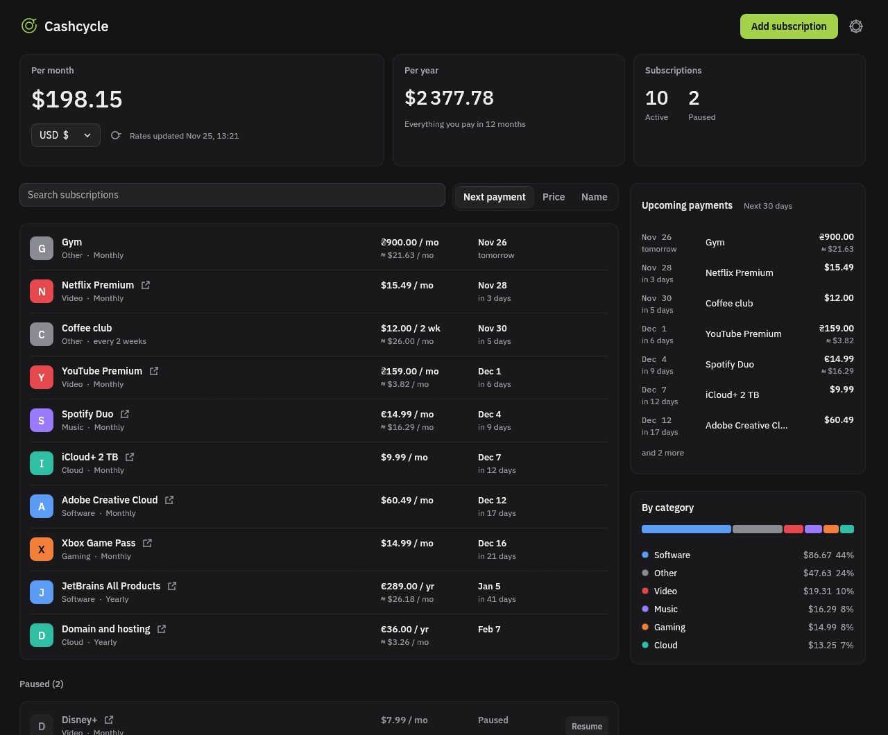
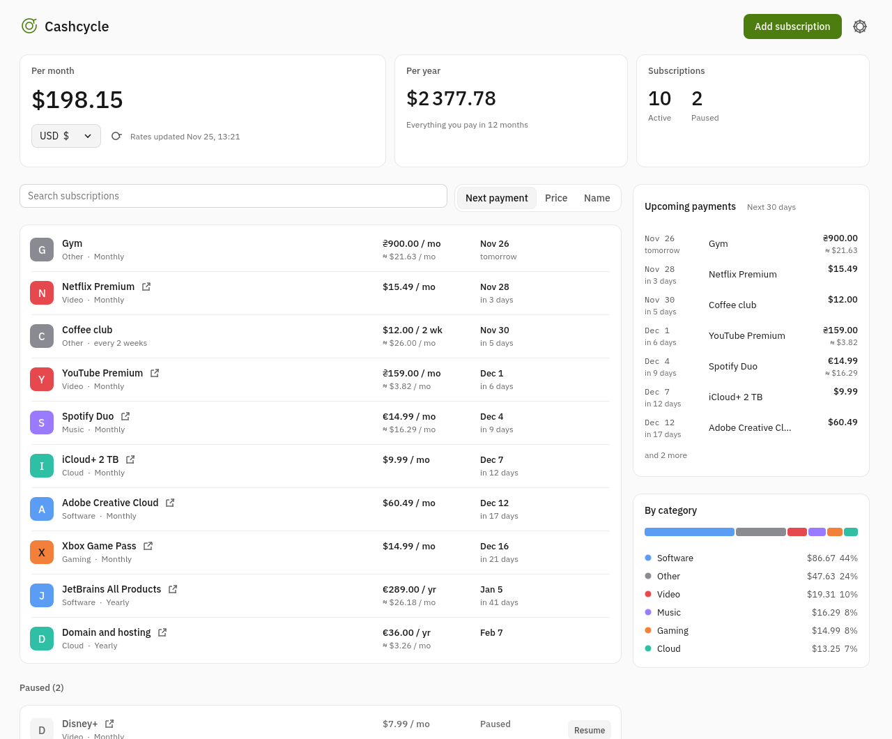
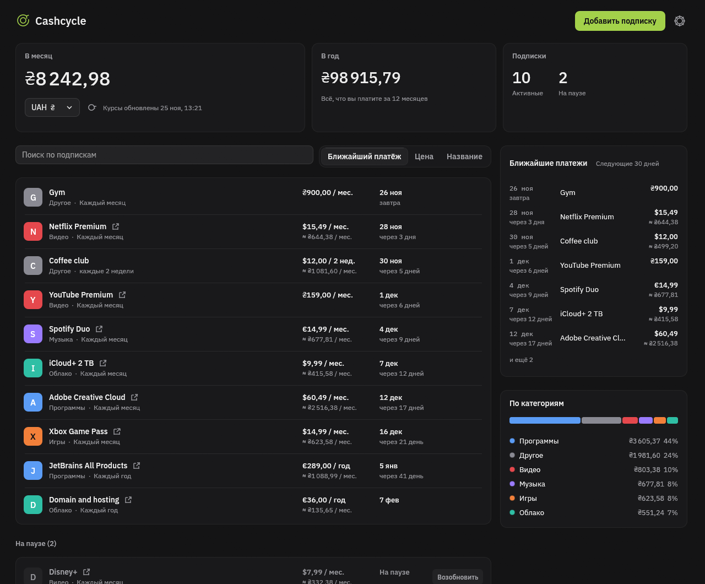
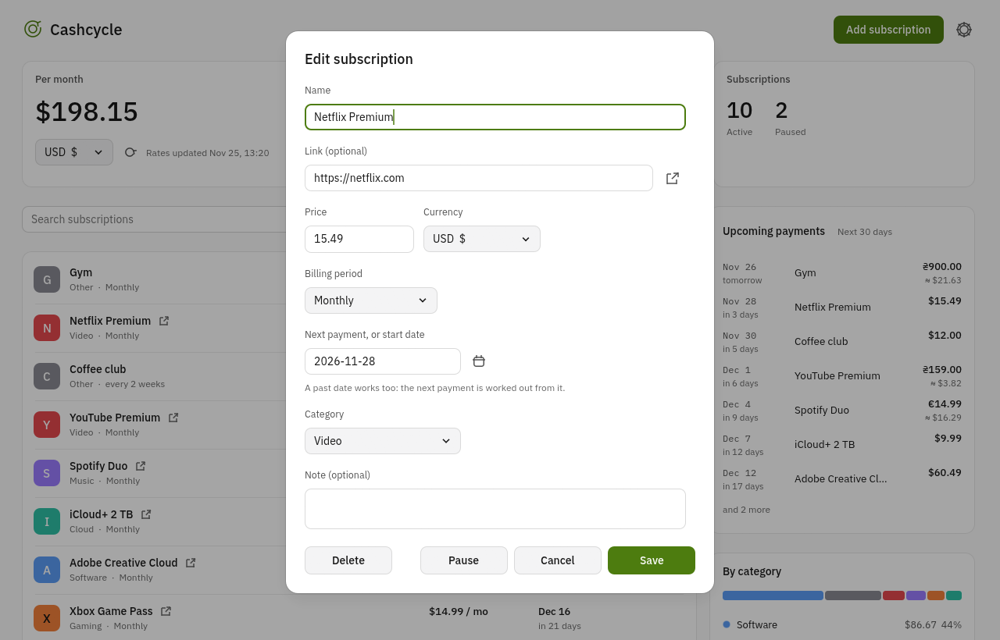
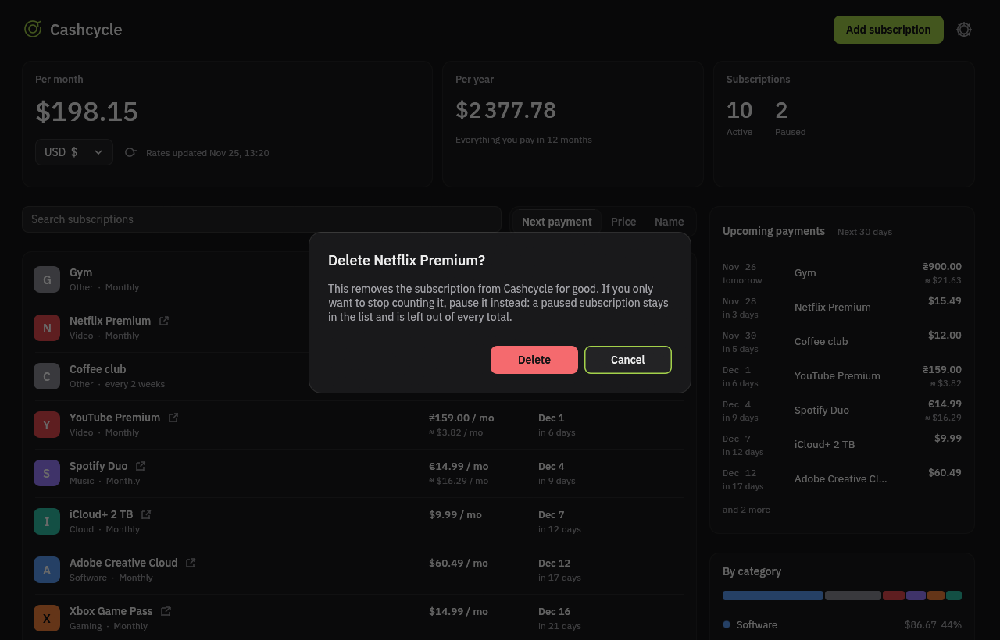
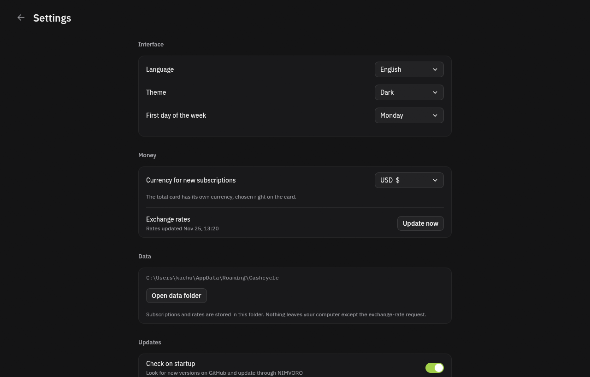

# Cashcycle

A clear tracker of your subscriptions and what they cost, for Windows and Linux. Add what you pay for, see the monthly and yearly total in the currency you choose, what is due in the next 30 days and where the money goes. No account, no cloud: your data stays on your computer. Part of the [NIMVORO](https://github.com/GrigoryyKach/nimvoro) suite.



## Features

- **Subscriptions.** Name (required), an optional link that opens in the browser (`https://` is added if you leave it out), price (`9.99` and `9,99` both work), **a currency per subscription**, a billing period (weekly, monthly, quarterly, yearly or custom "every N days, weeks or months"), the next payment or a start date, an optional category and a note. Pick a currency from a searchable list: your recent ones first, then USD, EUR and UAH, then every other currency the rate source covers. (The Russian and Belarusian roubles are deliberately not offered.)
- **Payment dates roll forward by themselves.** Enter the next payment, or any past one as a start date; the next payment is worked out from it. Month ends do not drift: a payment on the 31st falls on Feb 28 (29), Mar 31, Apr 30 and so on.
- **Totals.** The monthly total normalises every period to a month (weekly x 52 / 12, quarterly / 3, yearly / 12, custom by the same rule; a year is 12 months or 52 weeks). The yearly total, and the number of active and paused subscriptions, sit next to it.
- **Any currency for the total.** Choose the currency right on the total card. Every subscription is converted at **live exchange rates**, downloaded on start, every 6 hours and with the refresh button. The card says when ("Rates updated 14:02"). Offline, the last saved rates are used and the card says so ("No connection · using rates from 25 Nov"); with no rates at all you see totals per currency instead of a converted number. See [docs/RATES.md](docs/RATES.md).
- **Pause.** A paused subscription is excluded from all totals and from upcoming payments, is shown muted in its own "Paused" section and has a **Resume** button. Pause it until a date and it resumes by itself. Deleting asks first and points to pausing as the gentler option.
- **Upcoming payments.** The next 30 days, with the amount in its own currency and converted.
- **By category.** A flat bar and a list. Built-in categories (Video, Music, Software, Cloud, Gaming, Other) and your own.
- **The list.** Search, and sort by next payment, price (converted) or name. Each row shows a coloured letter tile, the price with currency and period, the monthly equivalent in your currency, and the next date.
- **Settings.** Theme (system, light, dark), language (English, Russian, Ukrainian), first day of the week (Monday, Sunday or Saturday; used by the date picker), the default currency for new subscriptions, the data folder, update check, Support, About.







## Data

Everything is stored in `%APPDATA%\Cashcycle\` on Windows and `~/.config/Cashcycle/` on Linux:

| File | Content |
|---|---|
| `data.json` | Subscriptions and your categories (versioned schema, migrated on load; prices are exact decimal strings) |
| `config.json` | Settings, the total-card currency, sort order, window position |
| `rates.json` | The last downloaded exchange rates, used only when there is no connection |
| `backups\data-YYYY-MM-DD.json` | One automatic backup per day, the last 14 are kept |
| `backups\before-schema-*.json` | The exact old file, kept before the first save after a schema upgrade |

Writes are atomic (temp file, then rename). If `data.json` cannot be read, it is renamed to `data.corrupt-<timestamp>.json` and never overwritten; Cashcycle starts empty and tells you.

To test without touching your data, set `CASHCYCLE_DATA_DIR` to a folder. `--demo` shows made-up subscriptions and fixed rates, reads nothing and writes nothing. `CASHCYCLE_OFFLINE=1` makes the rate download fail, to see the offline state.

Screenshots are made by the app itself, with no input sent to any window:

```powershell
.\Cashcycle.exe --demo --theme dark --lang en --size 1280x1060 --screenshot shot.png
# also: --view settings|new|edit|delete|pause|empty|norates   --offline   --lang ru|uk   --theme light
```

## Platforms

- **Windows** 10/11 x64: `Cashcycle-win-x64.zip` from the release, or via the NIMVORO launcher.
- **Linux** x86_64, X11 and Wayland (built on Ubuntu 22.04): `Cashcycle-linux-x64.tar.gz` from the release, or via the NIMVORO launcher. Run `./cashcycle`. It needs `curl` (exchange rates) and `xdg-utils` (opening links and the data folder). Not verified on a live Wayland session.

Config on Linux lives in `~/.config/Cashcycle`. There is no tray icon and no single-instance logic: Cashcycle is a normal window.

## Languages

English (default), Russian and Ukrainian. The starting language follows the NIMVORO rule: `language` from the app's own config, otherwise the launcher marker `.nimvoro.json` next to the exe, otherwise English. Russian and Ukrainian write the decimal comma.

## Build

Rust 2021, eframe/egui 0.37.

```powershell
cargo build --release   # target\release\Cashcycle.exe (target/release/Cashcycle on Linux)
cargo test
```

Locally the GNU toolchain is used; CI (`.github/workflows/release.yml`) builds with MSVC (Windows job) and on Ubuntu 22.04 (Linux job) when a `vX.Y.Z` tag is pushed and publishes `Cashcycle-win-x64.zip` and `Cashcycle-linux-x64.tar.gz` in one release. On Linux: `sudo apt install build-essential pkg-config libxkbcommon-dev libwayland-dev libx11-dev libxcb1-dev`.

Not in 1.0.0: reminders before a payment ("remind me N days before"). They need a notification identity on Windows and a notification service on Linux, which would turn this window-only app into a tray app; it is planned as a follow-up.

## Exchange rates

Exchange rates by [Exchange Rate API](https://www.exchangerate-api.com) (open access, attribution required), with the National Bank of Ukraine as the fallback source. Details and limits: [docs/RATES.md](docs/RATES.md).

## Support

If you find this app useful, you can support its development: <https://donatello.to/MicsGame>


## Updates

Without the launcher, the **Update** button updates the app by itself: it downloads the release archive from GitHub, checks its SHA-256 against the digest GitHub publishes for the asset, swaps the files (the old ones become `*.old`, are removed on the next start, and any failure rolls back) and restarts the app. If the app folder is not writable, the release page opens instead.

## Licence

MIT, see [LICENSE](LICENSE). The bundled IBM Plex fonts are licensed under the SIL Open Font License 1.1 (`assets/fonts/OFL.txt`).
